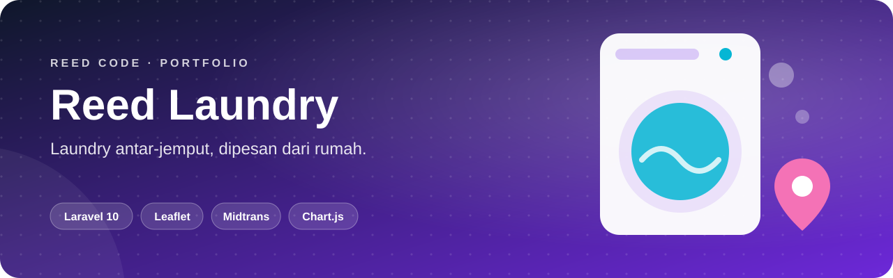
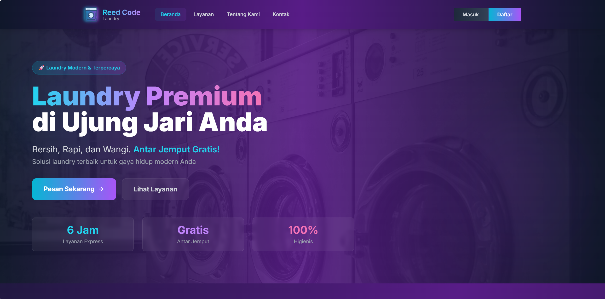
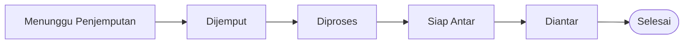

<p align="center">
  
</p>

<p align="center">
  <b>Cucian dijemput, dicuci, dan diantar kembali.</b> Sistem manajemen laundry dengan pemesanan online, peta antar-jemput, serta pembayaran Midtrans atau COD.
</p>

<p align="center">
  <a href="#sekilas">Sekilas</a> ·
  <a href="#kemampuan">Kemampuan</a> ·
  <a href="#alur-kerja">Alur Kerja</a> ·
  <a href="#mulai-menjalankan">Mulai Menjalankan</a> ·
  <a href="#akun-demo">Akun Demo</a>
</p>

<p align="center">
  
  <br>
  
  
  
</p>

## Sekilas

**Reed Laundry** memindahkan usaha laundry antar-jemput ke web. **Pelanggan** memesan dari rumah dan menentukan alamat langsung di peta. **Karyawan** memproses pesanan dari penjemputan sampai pengantaran. **Admin** memantau semuanya lewat dashboard bergrafik.

<p align="center">
  
</p>

## Kemampuan

<table>
  <tr>
    <th width="33%">🙋 Pelanggan</th>
    <th width="33%">👷 Karyawan</th>
    <th width="33%">🛡️ Admin</th>
  </tr>
  <tr>
    <td valign="top">
      • Pesan banyak layanan sekaligus<br>
      • Simpan beberapa alamat lewat peta<br>
      • Bayar via Midtrans atau COD<br>
      • Pantau status & riwayat pesanan
    </td>
    <td valign="top">
      • Terima email setiap pesanan baru<br>
      • Update status pesanan<br>
      • Isi jumlah/berat setelah penimbangan
    </td>
    <td valign="top">
      • Dashboard statistik + grafik<br>
      • Kelola jenis layanan & harga<br>
      • Kelola admin, karyawan, pelanggan<br>
      • Pantau status online pengguna
    </td>
  </tr>
</table>

| Fitur | Detail |
|---|---|
| 📍 **Area layanan** | Alamat dipilih di peta Leaflet dan divalidasi dalam **radius 2 km** dari outlet |
| 🧾 **14 layanan siap pakai** | Sprei, bedcover, selimut bulu, boneka, sepatu, jas, jaket jeans, sajadah, wearpack, dan lainnya. Admin bebas menambah layanan & harga |
| 📧 **Notifikasi email** | Pelanggan dan seluruh karyawan menerima email saat pesanan dibuat |

## Alur Kerja



Status pembayaran Midtrans dicatat terpisah: `Menunggu Pembayaran` → `Selesai` atau `Gagal`.

## Mulai Menjalankan

> Butuh **PHP 8.1+**, **Composer**, **Node.js 16+**, dan **MySQL**.

```bash
git clone https://github.com/KyyStacy/laundry-management-laravel.git
cd laundry-management-laravel

composer install && npm install
cp .env.example .env && php artisan key:generate

php artisan migrate --seed

npm run dev            # terminal 1
php artisan serve      # terminal 2  →  http://localhost:8000
```

<details>
<summary><b>Konfigurasi <code>.env</code></b></summary>

<br>

| Kunci | Fungsi |
|---|---|
| `DB_DATABASE`, `DB_USERNAME`, `DB_PASSWORD` | Koneksi MySQL |
| `MAIL_HOST`, `MAIL_USERNAME`, `MAIL_PASSWORD` | SMTP untuk notifikasi pesanan |
| `MIDTRANS_MERCHANT_ID`, `MIDTRANS_CLIENT_KEY`, `MIDTRANS_SERVER_KEY` | Kredensial Midtrans |
| `MIDTRANS_IS_PRODUCTION` | `false` untuk sandbox |

</details>

<details>
<summary><b>Menyesuaikan lokasi outlet & Midtrans</b></summary>

<br>

- Koordinat outlet dan radius layanan ada di `resources/views/addresses/create.blade.php` (`centerLat`, `centerLon`, `maxDistance`).
- Atur **Payment Notification URL** Midtrans ke `https://domain-kamu/payment-notification`.

</details>

## Akun Demo

Semua akun memakai password `password`.

| Role | Email |
|---|---|
| Admin | `admin@reedcode.id` |
| Karyawan | `karyawan1@reedcode.id` · `karyawan2@reedcode.id` |
| Pelanggan | `budi.santoso@reedcode.id` · `siti.nurhaliza@reedcode.id` · `ahmad.hidayat@reedcode.id` |

---

<div align="center">

<h2>Dibuat oleh Kyy Stacy × Reed Code</h2>

<p><i>Web & app developer: dari landing page sampai sistem bisnis custom.</i></p>

<a href="https://www.instagram.com/reedcode.id"></a>
<a href="https://www.tiktok.com/@reedcode.id"></a>
<a href="https://github.com/KyyStacy"></a>

<br><br>

<table>
  <tr>
    <td colspan="4" align="center"><b>Punya ide aplikasi atau butuh website untuk bisnismu?</b><br><sub>Reed Code siap bantu dari desain sampai online.</sub></td>
  </tr>
  <tr>
    <td align="center" width="25%">🌐<br><b>Company Profile</b><br><sub>Website brand & usaha</sub></td>
    <td align="center" width="25%">🛒<br><b>Toko Online</b><br><sub>Katalog & pembayaran online</sub></td>
    <td align="center" width="25%">📊<br><b>Sistem Bisnis</b><br><sub>Kasir, inventaris, booking</sub></td>
    <td align="center" width="25%">📱<br><b>Aplikasi Mobile</b><br><sub>Android & iOS</sub></td>
  </tr>
</table>

<a href="https://wa.me/6285171713355?text=Halo%20Reed%20Code%2C%20saya%20tertarik%20dengan%20jasa%20pembuatan%20website"></a>

<br><br>

<sub>© 2026 Kyy Stacy · Reed Code</sub>

</div>
